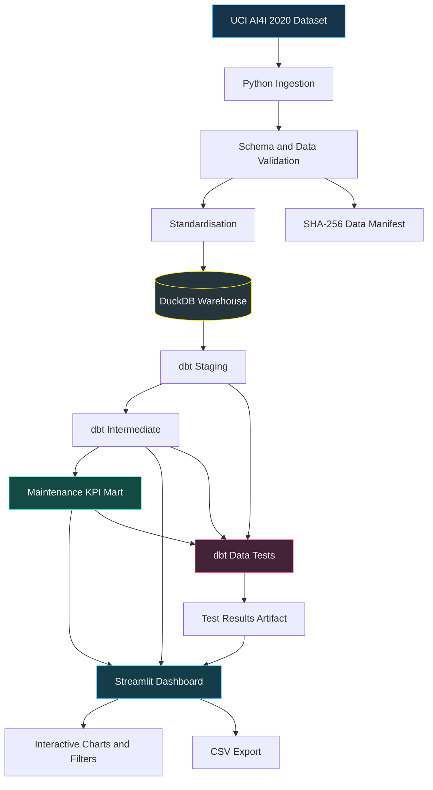

# ⚡ IndustrialPulse — Energy Intelligence

<p align="center">
  <strong>Turning industrial sensor data into actionable reliability intelligence.</strong>
  <br />
  An end-to-end analytics engineering platform inspired by modern energy, power generation, and industrial asset operations.
  <br /><br />
  <a href="https://industrialpulse-energy-intelligence-mmfxzskl2g6bajkyanlg2n.streamlit.app/">
    
  </a>
  <a href="https://github.com/souravgupta166/IndustrialPulse-Energy-Intelligence">
    
  </a>
  
  
  
  
  
</p>

---

## 🚀 Explore the live platform

**[OPEN INDUSTRIALPULSE DASHBOARD →](https://industrialpulse-energy-intelligence-mmfxzskl2g6bajkyanlg2n.streamlit.app/)**

IndustrialPulse is an interactive industrial analytics portfolio project that transforms the UCI AI4I 2020 Predictive Maintenance dataset into a tested, documented, and queryable analytics warehouse.

Explore failure rates, investigate sensor relationships, compare machine types, inspect data-quality controls, and export filtered observations through a custom-built Streamlit dashboard.

> **The vision:** bring together the engineering discipline of analytics pipelines and the usability of an industrial intelligence product.

This is an independent portfolio project inspired by the energy and industrial technology sector. It is not affiliated with Siemens Energy and does not reproduce its proprietary software or internal systems.

## 🧭 Navigate the platform

| Workspace | What you can explore |
|---|---|
| ⚡ Command Centre | Operational KPIs, machine-type comparisons, failure signals and sensor relationships |
| 🔎 Failure Intelligence | Failure rates, recorded failure-mode flags and sensor distributions by outcome |
| 🧪 Sensor Laboratory | Interactive sensor selection, correlation analysis and descriptive statistics |
| 🛡️ Data Quality Centre | Source manifest, validation metadata, dbt test artifacts and transformation lineage |
| 📊 Data Explorer | Filtered records, source-record lookup and CSV exports |

**Try this investigation:** open the Command Centre, compare the observed failure rates across machine types L, M and H, then open the Sensor Laboratory to investigate torque, rotational speed and tool wear.

---

## 📈 What the data reveals

The initial analysis covers **10,000 synthetic machine observations** from the AI4I 2020 Predictive Maintenance dataset.

| Metric | Observed result |
|---|---:|
| Total observations | 10,000 |
| Recorded machine-failure observations | 339 |
| Overall observed failure rate | 3.39% |
| Machine types | 3 |
| Source columns | 12 |
| Missing source values at initial validation | 0 |
| dbt data tests passed in the initial local test run | 36 / 36 |

### Failure-rate comparison

```text
Observed failure rate by machine type

L  ████████████████████  3.92%
M  ██████████████        2.77%
H  ██████████            2.09%
```

These percentages are based on the initial full-dataset analysis, before applying interactive dashboard filters.

- **Type L:** 235 recorded failures across 6,000 observations.
- **Type M:** 83 recorded failures across 2,997 observations.
- **Type H:** 21 recorded failures across 1,003 observations.

Type L has the highest observed failure rate in this dataset. This is a descriptive finding, not evidence that machine type causes failures.

The dataset contains synthetic observations, not live industrial telemetry. These results should not be interpreted as real-world plant reliability statistics.

---

## 🏗️ Architecture: from raw data to intelligence

IndustrialPulse follows a layered analytics engineering workflow. Python handles ingestion and validation, DuckDB provides the local analytical warehouse, dbt manages SQL transformations and tests, and Streamlit presents the results.



### The four data layers

| Layer | Model / component | Responsibility |
|---|---|---|
| Source | AI4I CSV | Original dataset and source provenance |
| Staging | `stg_ai4i_machine_data` | Standardised column names and source interface |
| Intermediate | `int_machine_observations` | Derived features, failure flags and reporting categories |
| Mart | `mart_maintenance_kpis` | Machine-type aggregates for business reporting |

The staging and intermediate models are configured as views, while the KPI mart is materialised as a table.

### Why this architecture?

- **Separation of concerns:** ingestion, transformations, quality checks and visualisation have distinct responsibilities.
- **Reproducibility:** the source validation manifest records the row count, schema, checksum and validation timestamp.
- **Testability:** dbt tests check data assumptions throughout the transformation layers.
- **Portability:** DuckDB allows the project to run locally without a separately managed database server.
- **Extensibility:** the layered structure can later support more datasets, additional marts, or a managed warehouse such as Snowflake.

---

## 🧮 The analytics and mathematical logic

The dashboard is designed to explain not just what the numbers are, but how they are calculated.

### 1. Observed failure rate

For a group of observations \(G\):

\[
\text{Failure Rate}_G =
\frac{\sum_{i \in G} y_i}{|G|}\times100
\]

where \(y_i=1\) when the source records a machine failure and \(0\) otherwise.

For type L:

\[
\frac{235}{6000}\times100 \approx 3.92\%
\]

The metric is calculated using the selected observations. When a user changes dashboard filters, the reported rate changes accordingly.

### 2. Temperature differential

The intermediate model calculates:

\[
\Delta T_i = T_{\text{process},i} - T_{\text{air},i}
\]

This feature represents the temperature difference between the process and surrounding air for each observation.

The mart aggregates the average temperature differential by machine type:

\[
\overline{\Delta T}_G =
\frac{1}{|G|}\sum_{i \in G}\Delta T_i
\]

This is a descriptive sensor feature, not a validated overheating threshold.

### 3. Average sensor measurements

For torque, rotational speed, tool wear and temperature measurements, the dashboard uses arithmetic means:

\[
\bar{x}_G = \frac{1}{n}\sum_{i=1}^{n}x_i
\]

These aggregates help compare operating conditions across machine types or filtered observations.

### 4. Failure-mode flag counts

The source contains separate binary flags for:

- Tool-wear failure (`TWF`)
- Heat-dissipation failure (`HDF`)
- Power failure (`PWF`)
- Overstrain failure (`OSF`)
- Random failure (`RNF`)

For failure mode \(j\):

\[
C_j = \sum_{i=1}^{n} f_{ij}
\]

where \(f_{ij}\) is the binary flag for observation \(i\) and failure mode \(j\).

**Important:** failure-mode flags can overlap. Their counts must not be added together and interpreted as unique failure incidents.

### 5. Failure-mode count per observation

The intermediate model computes:

\[
F_i = TWF_i + HDF_i + PWF_i + OSF_i + RNF_i
\]

This counts the number of recorded failure-mode flags in an observation. It is not a unique-incident count.

### 6. Sensor correlations

The Sensor Laboratory uses Pearson correlation for numeric variables:

\[
r_{XY} =
\frac{\operatorname{Cov}(X,Y)}
{\sigma_X\sigma_Y}
\]

The coefficient ranges from -1 to +1 and describes linear association.

Correlation does not establish causation, and relationships found in this synthetic dataset may not generalise to actual industrial equipment.

### 7. Data-quality assertions

The project combines source validation and dbt tests.

| Check | Purpose |
|---|---|
| Expected schema | Detect unexpected or reordered source columns |
| Completeness | Reject missing values in the validated source |
| Numeric validity | Reject invalid, non-finite or negative sensor values where prohibited by the validation rules |
| Domain validation | Restrict machine type to L, M or H |
| Binary flag validation | Restrict failure flags to 0 or 1 |
| Unique identifiers | Verify that `source_record_id` is unique and non-null |
| KPI business rules | Reject impossible counts and failure percentages outside 0–100 |

The initial local test run passed all 36 dbt data tests. This is a recorded development result, not a guarantee that every future deployment or execution will pass.

---

## 🧰 Technology stack

| Technology | Role in IndustrialPulse |
|---|---|
| Python | Data ingestion, validation and standardisation |
| pandas | Data manipulation and descriptive analysis |
| DuckDB | Embedded analytical warehouse |
| SQL | Transformations and analytical calculations |
| dbt Core | Layered models, documentation and data tests |
| dbt-duckdb | DuckDB integration for dbt |
| Streamlit | Interactive dashboard and application interface |
| Plotly | Interactive charts, scatter plots, box plots and correlation heatmaps |
| pytest | Python unit tests for validation and standardisation |
| Git and GitHub | Source control and collaboration |
| GitHub Actions | CI workflow configuration |

---

## 🚀 Run IndustrialPulse locally

### Prerequisites

- Python 3.12 or a compatible Python version supported by the pinned dependencies
- Git
- Internet access for downloading the public dataset
- A Windows PowerShell terminal, or an equivalent shell on Linux/macOS

### 1. Clone the repository

```bash
git clone https://github.com/souravgupta166/IndustrialPulse-Energy-Intelligence.git
cd IndustrialPulse-Energy-Intelligence
```

### 2. Create a virtual environment

**Windows PowerShell**

```powershell
py -3.12 -m venv .venv
.\.venv\Scripts\python.exe -m pip install --upgrade pip
.\.venv\Scripts\python.exe -m pip install -r requirements.txt
```

Using the explicit Python executable avoids relying on PowerShell activation policies.

**Linux/macOS**

```bash
python3 -m venv .venv
.venv/bin/python -m pip install --upgrade pip
.venv/bin/python -m pip install -r requirements.txt
```

### 3. Initialise the warehouse

The initialisation script downloads the dataset when needed, validates and standardises it, loads DuckDB, creates the deployment-compatible dbt profile, builds the models and runs the tests.

**Windows PowerShell**

```powershell
.\.venv\Scripts\python.exe -m scripts.initialize_warehouse
```

**Linux/macOS**

```bash
.venv/bin/python -m scripts.initialize_warehouse
```

The generated DuckDB database and local data files are intentionally excluded from Git. The initialisation workflow recreates them locally.

### 4. Launch the dashboard

**Windows PowerShell**

```powershell
.\.venv\Scripts\python.exe -m streamlit run dashboard/app.py
```

**Linux/macOS**

```bash
.venv/bin/python -m streamlit run dashboard/app.py
```

Open the local URL displayed by Streamlit, usually `http://localhost:8501`.

---

## 🧪 Run the tests independently

After the warehouse has been initialised, use the following commands.

**Python unit tests**

```powershell
.\.venv\Scripts\python.exe -m pytest -v
```

**dbt parsing and model build**

```powershell
.\.venv\Scripts\dbt.exe parse --profiles-dir .dbt_profiles
.\.venv\Scripts\dbt.exe run --profiles-dir .dbt_profiles
```

**dbt data tests**

```powershell
.\.venv\Scripts\dbt.exe test --profiles-dir .dbt_profiles
```

If you use a different profile directory, adjust the `--profiles-dir` argument accordingly.

---

## 📂 Repository structure

```text
IndustrialPulse-Energy-Intelligence/
│
├── dashboard/
│   ├── __init__.py
│   └── app.py
│
├── data/
│   ├── raw/                 # Downloaded source data, ignored by Git
│   ├── processed/           # Standardised data and DuckDB, ignored by Git
│   └── synthetic/
│
├── ingestion/
│   ├── download_ai4i.py
│   ├── validate_ai4i.py
│   ├── standardize_ai4i.py
│   └── load_local_warehouse.py
│
├── models/
│   ├── staging/
│   │   ├── sources.yml
│   │   ├── stg_ai4i_machine_data.sql
│   │   └── stg_ai4i_machine_data.yml
│   ├── intermediate/
│   │   ├── int_machine_observations.sql
│   │   └── int_machine_observations.yml
│   └── marts/
│       ├── mart_maintenance_kpis.sql
│       └── mart_maintenance_kpis.yml
│
├── scripts/
│   └── initialize_warehouse.py
│
├── tests/
│   ├── test_validate_ai4i.py
│   ├── test_standardize_ai4i.py
│   └── assert_mart_failure_metrics_valid.sql
│
├── .github/
│   └── workflows/
│       └── dbt-ci.yml
│
├── dbt_project.yml
├── requirements.txt
├── .env.example
├── .gitignore
└── README.md
```

Generated files and the local database are excluded from the repository to keep the source code portable and avoid committing large data files or machine-specific configuration.

---

## ☁️ Deployment

The live dashboard is deployed on Streamlit Community Cloud.

**[Launch the live IndustrialPulse dashboard](https://industrialpulse-energy-intelligence-mmfxzskl2g6bajkyanlg2n.streamlit.app/)**

The application initialises its data warehouse when needed, rather than requiring a committed DuckDB database.

For deployment reliability, the project keeps its generated data and local warehouse separate from source control. A fresh environment can rebuild them from the public dataset and committed transformation code.

### Current deployment considerations

- The application uses local DuckDB storage, which is suitable for a portfolio demonstration.
- The warehouse may need to be rebuilt after a fresh environment or reset.
- The available dataset is synthetic and does not stream live sensor data.
- The dbt quality page reads available test artifacts; displaying a previous test result is not the same as rerunning tests.
- Production use would require durable storage, scheduled ingestion, monitoring, access controls and a production-grade data platform.

---

## 🔭 Roadmap

The next potential improvements are:

- [ ] Add a predictive-maintenance model with a leakage-aware evaluation strategy.
- [ ] Introduce precision, recall, F1-score and precision-recall analysis for imbalanced failure classes.
- [ ] Add temporal monitoring when a suitable time-series dataset becomes available.
- [ ] Expand the dimensional model with explicit fact and dimension tables.
- [ ] Add freshness, reconciliation and distribution-drift checks.
- [ ] Strengthen CI to build the warehouse and run Python and dbt tests in a clean environment.
- [ ] Add deployment health checks and durable warehouse options.
- [ ] Explore a Snowflake deployment target while retaining DuckDB for local development.

These are planned enhancements, not claims about existing functionality.

---

## 📚 Data source and responsible interpretation

**Dataset:** [AI4I 2020 Predictive Maintenance Dataset — UCI Machine Learning Repository](https://archive.ics.uci.edu/dataset/601/ai4i+2020+predictive+maintenance+dataset)

The dataset is intended for predictive-maintenance research and contains synthetic observations of machine operating conditions and failure labels.

IndustrialPulse uses the dataset to demonstrate analytics engineering, data validation, dimensional transformation patterns, exploratory analysis and dashboard development.

It does not establish the reliability of any real machine, diagnose actual equipment faults, or provide validated industrial failure predictions.

## 🤝 Contributions

Suggestions, bug reports and improvements are welcome through GitHub issues and pull requests.

When contributing:

1. Keep generated datasets, local databases and secrets out of Git.
2. Add or update tests for changes to validation or transformation logic.
3. Document changes to KPI definitions and assumptions.
4. Avoid describing synthetic observations as real industrial telemetry.

## 👤 Author

**Sourav Gupta**

Data Analytics · Analytics Engineering · Business Intelligence · Applied Data Science

- **GitHub:** [@souravgupta166](https://github.com/souravgupta166)
- **Project repository:** [IndustrialPulse-Energy-Intelligence](https://github.com/souravgupta166/IndustrialPulse-Energy-Intelligence)
- **Live demo:** [IndustrialPulse Dashboard](https://industrialpulse-energy-intelligence-mmfxzskl2g6bajkyanlg2n.streamlit.app/)

---

<p align="center">
  <strong>⚡ IndustrialPulse</strong>
  <br />
  <em>From raw signals to reliable analytics.</em>
</p>
